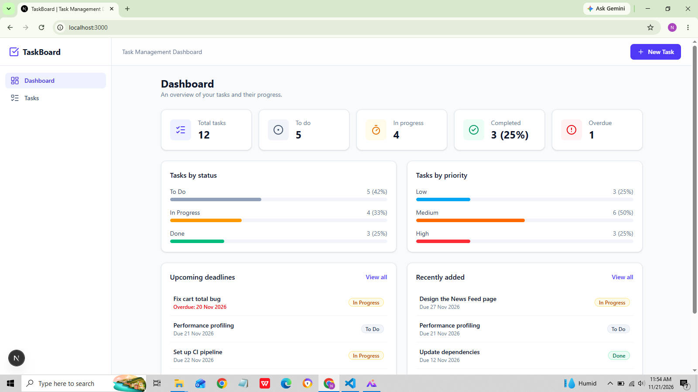
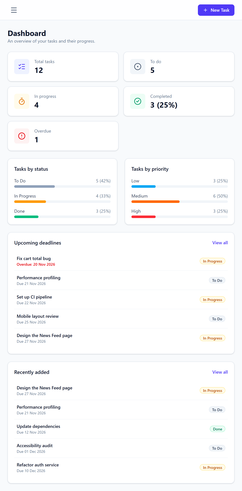
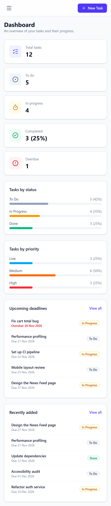

# TaskBoard: Task Management Dashboard

A responsive task management dashboard built with Next.js, React and TypeScript. It supports full CRUD, search, filtering, sorting, pagination, form validation, and clear loading, error, empty and success states.

## Features

- **Dashboard:** task totals, status and priority breakdowns, overdue count, upcoming deadlines and recently added tasks
- **Task management:** create, view, edit and delete tasks, with a delete confirmation dialog and a quick "Mark as done" action
- **Task list:** debounced search, status and priority filters, sorting and pagination, with all list state stored in the URL (shareable links, working Back button)
- **Task details:** full task view with an overdue warning and timestamps
- **Forms:** React Hook Form with Zod validation, inline error messages and a live character counter
- **UI states:** skeleton loaders, error cards with retry, empty states, "task not found" and 404 pages, and toast notifications
- **Responsive design:** fixed sidebar on desktop, slide-in drawer on tablet and mobile, and a table that becomes cards on phones
- **Accessibility:** skip link, labelled form controls, ARIA attributes, visible focus rings, keyboard-friendly dialogs and reduced-motion support

## Tech stack

| Area | Choice |
|---|---|
| Framework | Next.js (App Router) and React |
| Language | TypeScript (strict mode) |
| Styling | Tailwind CSS |
| Server state | TanStack Query |
| Forms and validation | React Hook Form and Zod |
| Mock API | JSON Server 0.17 |
| Icons and toasts | lucide-react and sonner |

## Getting started

### Prerequisites

- Node.js 20.9 or later
- npm

### Installation

```bash
git clone https://github.com/<your-username>/<repo-name>.git
cd <repo-name>
npm install
```

Create a `.env.local` file in the project root (you can copy `.env.example`):

```
NEXT_PUBLIC_API_URL=http://127.0.0.1:4000
```

### Run the application

Start the mock API and the frontend together:

```bash
npm run dev:all
```

- App: http://localhost:3000
- Mock API: http://127.0.0.1:4000/tasks

Or run them in two separate terminals:

```bash
npm run api   # mock API on port 4000
npm run dev   # Next.js on port 3000
```

### Available scripts

| Command | Purpose |
|---|---|
| `npm run dev:all` | Run the mock API and the app together |
| `npm run api` | Run only the mock API |
| `npm run dev` | Run only the Next.js dev server |
| `npm run build` | Create a production build |
| `npm run start` | Run the production build |
| `npm run lint` | Lint the code |

The mock data lives in `mock/db.json`. JSON Server writes changes back to this file, so tasks you create, edit or delete persist between runs.

## Project structure

```
src/
├── app/                        Routes (Next.js App Router)
│   ├── page.tsx                Dashboard
│   ├── tasks/
│   │   ├── page.tsx            Task list
│   │   ├── new/page.tsx        Create task
│   │   └── [id]/
│   │       ├── page.tsx        Task details
│   │       └── edit/page.tsx   Edit task
│   ├── layout.tsx              Root layout and metadata
│   ├── providers.tsx           React Query provider and toaster
│   ├── error.tsx               Global error boundary
│   └── not-found.tsx           Custom 404 page
├── components/
│   ├── ui/                     Reusable primitives (Button, Badge, Pagination, dialogs, states)
│   ├── layout/                 App shell (sidebar and header)
│   ├── dashboard/              Dashboard widgets
│   └── tasks/                  Task list, table, filters, form and details
├── hooks/                      React Query hooks, URL filter state, debounce
├── services/                   API client and task service
├── lib/                        Constants, validation schema, statistics and utilities
└── types/                      Shared TypeScript types
mock/
└── db.json                     JSON Server data
```

## Architecture and design decisions

**Layered structure.** Data flows in one direction: components call hooks, hooks call the service layer, and the service layer calls the API client. Components never call `fetch` directly, so replacing the mock API with a real backend only changes the code in `src/services`.

**Service layer.** `apiClient.ts` handles the base URL, headers and network failures, and turns errors into a typed `ApiError`. `taskService.ts` is the only module that knows endpoint paths and query parameters.

**Server state with TanStack Query.** Caching, loading and error states, retries and refetching come from React Query rather than hand-written `useEffect` code. Mutations invalidate the task queries, so the list, the details and the dashboard statistics refresh automatically. `keepPreviousData` keeps the old rows visible while the next page loads.

**URL as the source of truth for list state.** Search, filters, sorting and the page number live in the query string (`useTaskFilters`). Views can be shared, the Back button works and a refresh keeps the user's place. The search input is debounced to avoid a request on every keystroke.

**One form for create and edit.** `TaskForm` takes a `mode` prop, and a Zod schema factory applies mode-specific rules (for example, the due date cannot be in the past when creating a task). Validation runs on blur and on submit, and error messages are linked to their inputs with `aria-describedby`.

**Reusable UI primitives.** Button, badges, form field, pagination, confirm dialog, skeleton, and the empty and error states are shared across pages, which keeps the interface consistent.

**Typed end to end.** Shared types in `src/types` describe tasks, queries and paginated results. The service layer, hooks and components all use them, and the project compiles with TypeScript strict mode.

**Priority sorting.** JSON Server sorts text alphabetically (`high`, `low`, `medium`), which is wrong for priority. The service sorts priority on the client with a weight map instead.

**Accessibility and responsiveness.** The markup is semantic (a table with a caption, a description list for details, landmarks), with a skip link, labelled controls, focus-visible rings, `Escape` to close dialogs and the mobile drawer, and `prefers-reduced-motion` support. The task table turns into cards on small screens.

## Screenshots

### Dashboard and task list

| Dashboard | Task list |
|---|---|
|  |  |

### Forms and details

| Create form with validation | Task details |
|---|---|
|  |  |

### UI states

| Delete confirmation | Empty state | Error state |
|---|---|---|
|  |  |  |

### Responsive design

| Tablet | Mobile |
|---|---|
|  |  |

## Possible improvements

- Replace JSON Server with a real backend and add authentication
- Add unit and end-to-end tests (Vitest and Playwright)
- Add a drag-and-drop status board, task comments and due-date reminders